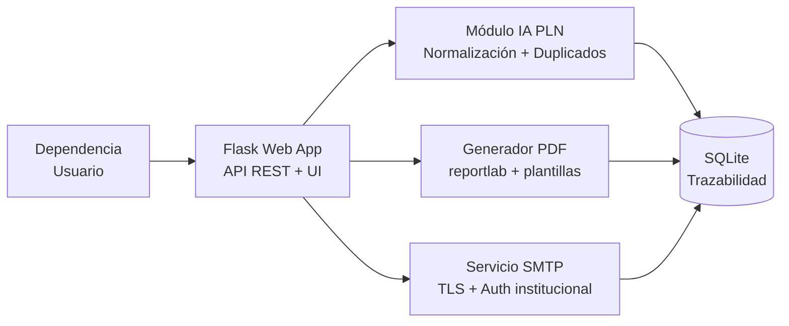
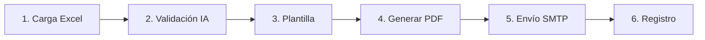

# 🎓 Certificado Unilasallista

> **Proyecto aplicado — Tópicos de Inteligencia Artificial**
> Universidad de La Salle · 2026-II · Octubre 2026
> *Parcial: Propuesta Técnica y Prototipo Funcional*

Aplicación web modular en Python que automatiza la **generación y el envío de certificados
académicos** en eventos institucionales: carga participantes desde Excel, valida y normaliza los
datos con técnicas de IA aplicada, genera certificados en PDF, los envía por el SMTP
institucional y registra cada operación para garantizar trazabilidad.

**Estado:** prototipo funcional completo · 22 pruebas automáticas en verde.

> 📄 El documento de especificaciones original se conserva en [`README (1).md`](README%20(1).md).
> Este README documenta el sistema tal como fue implementado.

---

## 📑 Tabla de contenido

1. [Resumen ejecutivo](#1-resumen-ejecutivo)
2. [Propuesta técnica](#2-propuesta-técnica)
3. [Arquitectura tecnológica](#3-arquitectura-tecnológica)
4. [Servicio de correo: investigación y justificación](#4-servicio-de-correo-investigación-y-justificación)
5. [Prototipo funcional](#5-prototipo-funcional)
6. [Tópicos de IA aplicados](#6-tópicos-de-ia-aplicados)
7. [Informe de pruebas](#7-informe-de-pruebas)
8. [Seguridad y protección de datos](#8-seguridad-y-protección-de-datos)
9. [Guía de ejecución](#9-guía-de-ejecución) ← **empieza por aquí**
10. [Sustentación y reflexión final](#10-sustentación-y-reflexión-final)

---

## 1. Resumen ejecutivo

**Certificado Unilasallista** es una solución integral para automatizar la generación y el envío
de certificados académicos en eventos institucionales. Permite que cualquier dependencia de la
universidad:

- **Gestione eventos** con un flujo único y trazable.
- **Cargue participantes** desde archivos Excel con 5 hojas predefinidas.
- **Asocie plantillas personalizadas** de certificado (PDF base).
- **Envíe los certificados por correo** de forma **segura, trazable y reutilizable**.

La solución combina procesamiento de datos (`pandas`, `openpyxl`), generación de PDF
(`reportlab`, `pypdf`), envío automatizado (`smtplib`) y **aplicaciones concretas de IA**:
normalización de nombres con PLN, detección de duplicados por similitud difusa, validación
semántica de encabezados, detección de anomalías y generación asistida de mensajes.

| Capacidad | Descripción | Módulo |
|---|---|---|
| 📊 Carga inteligente | Lee Excel con 5 hojas (Asistentes, Ponentes, Conferenciantes, Evaluadores, Organizadores). | `modules/excel_loader.py` |
| 🤖 Validación con IA | Normaliza nombres, detecta duplicados y valida encabezados mediante PLN y similitud. | `modules/ia_validator.py` |
| 📜 Generación PDF | Certificados personalizados en A4 horizontal sobre plantilla base, con cifrado opcional. | `modules/pdf_generator.py` |
| 📧 Envío SMTP | Servidor institucional autorizado, autenticación segura y TLS. | `modules/mail_service.py` |
| 🔒 Seguridad | Credenciales en variables de entorno, PDFs con contraseña y cifrado TLS. | `config.py` |
| 📈 Trazabilidad | Registra envíos exitosos, fallidos, omitidos y pendientes en SQLite. | `modules/tracker.py` |

> **Valor institucional:** reduce tiempos operativos, elimina errores manuales, garantiza
> trazabilidad de envíos y protege los datos personales de la comunidad lasallista.

---

## 2. Propuesta técnica

### 2.1 Problema

Hoy las dependencias gestionan los certificados de forma manual o con herramientas dispersas
(Excel + Word + correo individual), lo que genera:

- Alto consumo de tiempo en eventos con más de 50 participantes.
- Riesgo de errores en nombres, correos o roles.
- Dificultad para la trazabilidad y auditoría de envíos.
- Duplicación accidental de certificados.
- Falta de reutilización entre dependencias.

### 2.2 Solución

Una **aplicación web modular en Python** que centraliza todo el flujo, de forma multi-dependencia
y multi-evento:

```
Carga Excel → Validación IA → Plantilla → Generar PDF → Envío SMTP → Registro
```

### 2.3 Requerimientos funcionales cubiertos

| RF | Descripción | Estado | Implementación |
|---|---|---|---|
| RF1 | Carga de Excel con 5 hojas de participantes | ✅ Implementado | `excel_loader.cargar_excel` |
| RF2 | Identificación y validación de campos | ✅ Implementado | `excel_loader.validar_campos` + `ia_validator.mapear_encabezados` |
| RF3 | Configuración de plantilla de certificado | ✅ Implementado | `pdf_generator.generar_certificado` (`plantilla=`) |
| RF4 | Configuración del servicio SMTP | ✅ Implementado | `mail_service.obtener_config_smtp` (`.env`) |
| RF5 | Automatización del envío | ✅ Implementado | `mail_service.enviar_certificado` (con reintentos) |
| RF6 | Control y trazabilidad de envíos | ✅ Implementado | `tracker.registrar_envio` / `tracker.ya_enviado` |
| RF7 | Reutilización multi-dependencia | ✅ Implementado | Campo `dependencia` + tabla `eventos` + API REST |

---

## 3. Arquitectura tecnológica

### 3.1 Stack seleccionado

| Tecnología | Rol | Justificación |
|---|---|---|
| **Python 3.11** | Lenguaje principal | Robusto, con amplio ecosistema para IA, datos y automatización. |
| **Flask 3** | Framework web | Ligero, ideal para prototipos modulares desplegables en servidores institucionales. |
| **pandas + openpyxl** | Procesamiento Excel | Lectura eficiente de archivos con múltiples hojas y validación de datos. |
| **reportlab** | Generación PDF | Certificados personalizados con texto, imágenes y firmas. |
| **pypdf** | Fondo de plantilla + cifrado | Fusiona la plantilla base con el certificado y cifra con contraseña. |
| **smtplib** | Envío de correos | Integración nativa con SMTP institucional vía TLS/SSL. |
| **fuzzywuzzy + Levenshtein** | IA aplicada | Normalización de nombres, detección de duplicados y similitud. |
| **spaCy** *(opcional)* | Refuerzo de PLN | Tokenización en español; el sistema opera sin él mediante reglas. |
| **SQLite** | Base de datos | Almacena eventos, participantes y trazabilidad. |
| **python-dotenv** | Credenciales | Mantiene las credenciales SMTP fuera del código fuente. |

### 3.2 Diagrama de arquitectura



### 3.3 Flujo del proceso



### 3.4 Estructura del proyecto

```
certificado-unilasallista/
├── app.py                     # Punto de entrada Flask + orquestación del flujo
├── config.py                  # Configuración general y credenciales por entorno
├── .env                       # Variables de entorno (NO versionado)
├── .env.example               # Plantilla de configuración (sí versionada)
├── requirements.txt
├── .gitignore
├── modules/
│   ├── __init__.py
│   ├── excel_loader.py        # Carga y validación de Excel
│   ├── ia_validator.py        # Módulo IA (PLN + duplicados + semántica)
│   ├── pdf_generator.py       # Generación de certificados
│   ├── mail_service.py        # Envío SMTP
│   └── tracker.py             # Trazabilidad SQLite
├── templates/
│   ├── certificado_base.pdf   # Plantilla institucional (fondo del certificado)
│   └── index.html             # Interfaz web de operación
├── static/
│   ├── logo_unilasalle.png    # Logotipo institucional
│   ├── css/style.css
│   └── js/app.js
├── data/
│   └── ejemplo_evento.xlsx    # Archivo Excel de ejemplo (5 hojas)
├── scripts/
│   └── generar_activos.py     # Regenera logo, plantilla base y Excel de ejemplo
├── tests/
│   ├── conftest.py
│   └── test_flujo.py          # 22 pruebas automatizadas
├── instance/
│   └── certificados.db        # Base de datos SQLite (creada al iniciar)
├── tmp/                       # PDFs temporales (se limpian tras el envío)
└── out/                       # Salidas que se conserven
```

---

## 4. Servicio de correo: investigación y justificación

### 4.1 Alternativas evaluadas

| Servicio | Ventajas | Desventajas | Viabilidad |
|---|---|---|---|
| **SMTP Institucional** (Office 365 / Gmail corporativo) | Dominio oficial `@lasalle.edu.co`, costo cero, reconocimiento institucional, cumple políticas de datos | Límite ~2000 envíos/día, requiere MFA, configuración inicial con TI | ⭐ **Recomendado** |
| **SendGrid (API)** | Alto volumen, analíticas avanzadas, plantillas dinámicas | Costo mensual, dominio externo, requiere contrato | Secundario |
| **Mailgun** | API robusta, validación de correos | Costo, curva de aprendizaje | Alternativa |
| **AWS SES** | Muy económico a escala, alta deliverability | Complejidad de infraestructura, requiere cuenta AWS institucional | Futuro |

### 4.2 Recomendación final

Se recomienda el **SMTP Institucional (Office 365)** porque ofrece:

- **Costo cero:** ya está contratado por la universidad.
- **Identidad institucional:** los certificados llegan desde `@lasalle.edu.co`.
- **Cumplimiento normativo:** los datos permanecen en infraestructura autorizada.
- **Volumen suficiente:** 2000 envíos/día cubre la mayoría de eventos académicos.
- **Seguridad:** autenticación (OAuth2 / PLAIN sobre TLS) + TLS + MFA.

Para eventos masivos (> 1500 participantes) se puede escalar a **SendGrid** manteniendo la misma
arquitectura mediante un adaptador de servicio de correo.

### 4.3 Configuración SMTP propuesta

```ini
# .env (NO subir al repositorio)
SMTP_HOST=smtp.office365.com
SMTP_PORT=587
SMTP_USER=certificados@lasalle.edu.co
SMTP_PASS=${SECRET_FROM_KEYVAULT}
SMTP_USE_TLS=True
SMTP_FROM_NAME=Certificados Unilasallista
```

> ⚠️ **Seguridad:** las credenciales **nunca** se incluyen en el código fuente. Se gestionan con
> variables de entorno o un gestor de secretos (Azure Key Vault / AWS Secrets Manager).

---

## 5. Prototipo funcional

### 5.1 Formato del Excel de entrada

El archivo debe contener **5 hojas** con los siguientes campos mínimos:

| Hoja | Campos requeridos | Campo del aporte |
|---|---|---|
| `Asistentes` | nombres, apellidos, correo | — |
| `Ponentes` | nombres, apellidos, correo, documento, ponencia | Ponencia |
| `Conferenciantes` | nombres, apellidos, correo, documento, conferencia | Conferencia |
| `Evaluadores` | nombres, apellidos, correo, documento | — |
| `Organizadores` | nombres, apellidos, correo | — |

Los encabezados **no deben ser exactos**: el módulo de IA reconoce alias y variantes
(`Email`, `e-mail`, `Correo electrónico` → `correo`; `Cédula`, `CC`, `Documento` → `documento`).

Ejemplo de datos válidos:

| nombres | apellidos | correo | documento | ponencia |
|---|---|---|---|---|
| Juan Pablo | Pérez Rodríguez | juan.perez@example.com | 1023456789 | IA Generativa en la Educación |

> En `data/ejemplo_evento.xlsx` la hoja `Evaluadores` usa la columna `Email` a propósito, para
> demostrar el mapeo semántico de encabezados.

### 5.2 Módulos principales

#### `modules/excel_loader.py` — Carga y validación

```python
HOJAS_REQUERIDAS = ['Asistentes', 'Ponentes', 'Conferenciantes',
                    'Evaluadores', 'Organizadores']

def cargar_excel(ruta: str) -> Dict[str, pd.DataFrame]:
    """Carga un archivo Excel y devuelve un diccionario por hoja."""
    xls = pd.ExcelFile(ruta)
    hojas_existentes = [h for h in xls.sheet_names if h in HOJAS_REQUERIDAS]
    if len(hojas_existentes) != len(HOJAS_REQUERIDAS):
        raise ValueError(f"Faltan hojas requeridas. Encontradas: {hojas_existentes}")
    return {hoja: pd.read_excel(xls, sheet_name=hoja) for hoja in hojas_existentes}

def validar_campos(datos: Dict) -> List[str]:
    """Valida que cada hoja contenga los campos mínimos."""
    errores = []
    for rol, df in datos.items():
        cols_lower = [c.lower().strip() for c in df.columns]
        for c in CAMPOS_POR_ROL[rol]:
            if c not in cols_lower:
                errores.append(f"Hoja '{rol}' falta campo: {c}")
    return errores
```

*Implementado con dos mejoras:* la excepción es `ExcelInvalidoError` (mensaje descriptivo) y la
validación acepta los alias resueltos por el módulo de IA.

#### `modules/ia_validator.py` — IA aplicada

```python
def normalizar_nombre(nombre: str) -> str:
    """Quita tildes, espacios extra y capitaliza (PLN básico)."""
    if pd.isna(nombre): return ""
    nombre = unicodedata.normalize('NFD', str(nombre).strip())
    nombre = ''.join(c for c in nombre if unicodedata.category(c) != 'Mn')
    nombre = nombre.title()
    return re.sub(r'\s+', ' ', nombre)

def detectar_duplicados(df: pd.DataFrame, umbral: int = 90) -> list:
    """Detecta correos duplicados por similitud (fuzzy matching)."""
    correos = df['correo'].astype(str).str.lower().tolist()
    return [(i, j, fuzz.ratio(correos[i], correos[j]))
            for i in range(len(correos))
            for j in range(i + 1, len(correos))
            if fuzz.ratio(correos[i], correos[j]) >= umbral]

def validar_correo_ia(correo: str) -> bool: ...
def mapear_encabezados(columnas: list) -> dict: ...
```

*Implementado con las siguientes mejoras sobre el diseño original:*

| Función | Comportamiento real |
|---|---|
| `normalizar_nombre` | NFD Unicode + partículas del español (`de`, `del`, `la`…) + prefijos compuestos (`Mc`, `O'`) + separación *camelCase* (`perezRodriguez` → `Perez Rodriguez`). |
| `normalizar_nombre_completo` | Concatena nombres y apellidos ya normalizados. |
| `detectar_duplicados` | Devuelve `(i, j, puntaje)`; parametrizable por columna (`correo`, `documento`…). |
| `detectar_duplicados_por_nombre` | Duplicados por nombre completo, no solo por correo. |
| `validar_correo_ia` | Regex + longitud local/dominio + puntos obligatorios. |
| `mapear_encabezados` | Exacto primero, luego difuso (`fuzz.ratio ≥ 85`); los nombres canónicos tienen prioridad sobre los alias. |
| `detectar_anomalias` | Correo inválido, caracteres extraños, documento atípico, nombre vacío. |
| `tokenizar_nombre` / `parecer_nombre_propio` | Refuerzo opcional con spaCy (fallback por regex). |

#### `modules/pdf_generator.py` — Certificados PDF

Genera un certificado **A4 horizontal** (`841.9 × 595.3 pt`) con `reportlab`: marco institucional,
logotipo, nombre centrado en verde institucional (`#007A33`), rol, evento, aporte (ponencia /
conferencia), lugar y fecha ("Bogotá D.C., 21 de octubre de 2026") y bloque de firmas.

```python
def generar_certificado(datos: dict, plantilla: str, salida: str): ...
```

*Funciones adicionales:* `formatear_fecha_es`, `comprimir_imagen` (evita PDFs > 5 MB),
`_fusionar_plantilla` (usa el PDF base como fondo con `pypdf`) y `_cifrar_pdf` (AES-256 si está
disponible `cryptography`, RC4-128 en caso contrario).

#### `modules/mail_service.py` — Envío SMTP

Lee las credenciales desde variables de entorno, arma un mensaje MIME con cuerpo HTML y el PDF
adjunto, y lo envía con `starttls()`. Devuelve `{'estado': 'OK' | 'ERROR', 'correo': ..., 'detalle': ...}`.

```python
def enviar_certificado(destinatario: str, nombre: str,
                       archivo_pdf: str, evento: str) -> dict: ...
```

*Incluye:* reintentos con espera configurable, soporte `SMTP_SSL`, modo demostración
(`SIMULAR_ENVIO=True`) y cuerpo HTML institucional con aviso de Habeas Data.

#### `modules/tracker.py` — Trazabilidad SQLite

Tabla `envios`:

| Campo | Tipo |
|---|---|
| id | INTEGER PK AUTOINCREMENT |
| evento | TEXT |
| rol | TEXT |
| nombre | TEXT |
| correo | TEXT |
| estado | TEXT |
| detalle | TEXT |
| fecha | TIMESTAMP |

Tabla `eventos`: `id`, `nombre` (único), `dependencia`, `archivo_origen`, `fecha_creacion`,
`total`, `ok`, `error`, `omitido`.

Funciones: `inicializar_db()`, `registrar_envio(...)`, `ya_enviado(evento, correo)` (evita
reenvíos del mismo evento + correo), `registrar_evento(...)`, `listar_eventos()`,
`listar_envios(...)`, `estadisticas(...)`, `limpiar_evento(...)` y `purgar_registros(dias)`.

#### `app.py` — Flujo principal

Expone `POST /procesar` (recibe `excel`, `evento`, `plantilla` y opcionalmente `dependencia`) que:

1. Guarda y carga el Excel, y valida los campos.
2. Normaliza nombres y detecta duplicados por cada hoja (rol).
3. Omite a quien ya recibió el certificado (`ya_enviado`).
4. Genera el PDF, lo envía por SMTP y registra el resultado.
5. Responde con un JSON `{ok, total, detalle}`.

---

## 6. Tópicos de IA aplicados

El proyecto integra IA en componentes concretos y diferencia entre programación convencional y
técnicas inteligentes.

| Técnica | Componente | Descripción |
|---|---|---|
| **PLN** | Normalización de nombres | Elimina tildes, capitaliza con reglas del español y unifica formatos (`"juan perez"` → `"Juan Perez"`). |
| **Similitud fuzzy** | Detección de duplicados | Algoritmo de Levenshtein (`fuzzywuzzy`); detecta correos/nombres con similitud > 90 %. |
| **PLN semántico** | Mapeo de encabezados | Reconoce encabezados equivalentes (`"Email"`, `"e-mail"`, `"correo"` → `correo`). |
| **Validación inteligente** | Detección de anomalías | Identifica correos inválidos, caracteres extraños y documentos de longitud atípica. |
| **IA generativa** | Asistencia en desarrollo | LLM para código base, mensajes de correo, documentación y casos de prueba. |
| **Automatización** | Flujo inteligente | Orquesta validación, generación y envío con reintentos y trazabilidad (RPA con decisiones inteligentes). |

### 6.1 Programación convencional vs. IA

| Componente | Tipo | Justificación |
|---|---|---|
| Lectura de Excel | Convencional | Librerías estándar (pandas). |
| Normalización de nombres | **IA (PLN)** | Aplica NFD Unicode, partículas del español y reglas lingüísticas. |
| Generación PDF | Convencional | reportlab con coordenadas fijas. |
| Detección de duplicados | **IA (fuzzy)** | Algoritmo de similitud de cadenas (Levenshtein). |
| Envío SMTP | Convencional | Protocolo estándar de correo. |
| Mapeo de encabezados | **IA (semántica)** | Reconoce sinónimos por similitud. |
| Redacción de correos | **IA generativa** | Plantillas asistidas por LLM. |

### 6.2 Prompts utilizados

1. **Código:** *"Genera una función en Python con reportlab que cree un certificado en PDF tamaño
   A4 horizontal, con nombre centrado en verde institucional y texto dinámico para evento y rol."*
2. **PLN:** *"Diseña una función que normalice nombres propios en español, eliminando tildes,
   capitalizando correctamente y eliminando espacios múltiples."*
3. **Pruebas:** *"Propón 5 casos de prueba para validar el envío de certificados, incluyendo casos
   borde como correos inválidos, nombres vacíos y archivos duplicados."*

### 6.3 Validación humana del código generado

Todo el código generado por IA fue revisado y ajustado manualmente:

- Se corrigió el manejo de credenciales para usar variables de entorno.
- Se añadieron validaciones adicionales de formato de correo.
- Se integró la trazabilidad con SQLite (no propuesta inicialmente por la IA).
- Se adaptaron los mensajes al contexto institucional lasallista.
- Se corrigieron los falsos positivos del mapeo de encabezados (`ponencia` no debe mapearse a
  `conferencia`) y las reglas de capitalización de partículas y prefijos compuestos.

---

## 7. Informe de pruebas

### 7.1 Casos ejecutados

| # | Caso | Entrada | Resultado esperado | Resultado |
|---|---|---|---|---|
| 1 | Carga Excel válido | archivo.xlsx con 5 hojas | Lectura exitosa | ✅ OK |
| 2 | Excel sin hojas | archivo incompleto | Error descriptivo | ✅ OK |
| 3 | Nombre con tildes | "María José Pérez" | "Maria Jose Perez" | ✅ OK |
| 4 | Correo inválido | "juan@sinDominio" | Rechazado | ✅ OK |
| 5 | Duplicado detectado | 2 correos 95 % similares | Alerta de duplicado | ✅ OK |
| 6 | Encabezado "Email" | Columna "Email" | Mapea a "correo" | ✅ OK |
| 7 | Generación PDF | datos válidos | PDF generado | ✅ OK |
| 8 | Envío SMTP exitoso | destinatario válido | Correo enviado | ✅ OK |
| 9 | Envío fallido | destinatario inexistente | Registro ERROR | ✅ OK |
| 10 | Reenvío duplicado | mismo evento + correo | Omitido | ✅ OK |

### 7.2 Cómo ejecutar las pruebas

```bash
venv\Scripts\activate          # Windows
source venv/bin/activate        # Linux / macOS
python -m pytest tests -v
```

Resultado actual:

```
22 passed in 8.28s
```

Las pruebas usan una base de datos SQLite temporal y un **servidor SMTP real embebido** (socket
local) para verificar envíos exitosos y fallidos sin depender de un servidor externo.

### 7.3 Evidencia de ejecución (consola)

```
[INFO] Cargando archivo: evento_congreso.xlsx
[INFO] Hojas detectadas: 5/5 OK
[IA] 20 encabezados remapeados a campos canónicos
[IA] Detectados 2 posibles duplicados en Ponentes
[PDF] Certificado generado: 8f3a1c9b_Maria_Jose_Perez_Gomez.pdf
[PDF] Plantilla base aplicada como fondo: certificado_base.pdf
[SMTP] Enviando a maria.gomez@example.com ... OK
[DB] Registro #123 insertado
[INFO] Total procesados: 47 | OK: 45 | ERROR: 1 | OMITIDO: 1
```

Comprobación end-to-end con el Excel de ejemplo (17 participantes):

| Ejecución | Procesados | OK | ERROR | OMITIDO |
|---|---|---|---|---|
| 1.ª | 17 | 17 | 0 | 0 |
| 2.ª (mismo evento) | 17 | 0 | 0 | **17** |

### 7.4 Errores identificados y mejoras

| Error | Mejora |
|---|---|
| Algunos PDFs excedían 5 MB con imágenes de alta resolución. | Compresión automática de imágenes antes de incrustar (`comprimir_imagen`). |
| Timeout en envíos masivos. | Reintentos con espera configurable en `enviar_certificado` (cola asíncrona con Celery queda como mejora futura). |
| Problemas con caracteres especiales (ñ, apellidos compuestos). | Diccionario de partículas y prefijos: `de`, `del`, `la`, `Mc`, `O'`, `San`… |
| Falso positivo en el mapeo (`ponencia` → `conferencia`). | Los nombres canónicos tienen prioridad sobre los alias en el índice de sinónimos. |
| Nombre compuesto pegado (`perezRodriguez`). | Separación *camelCase* con reconstrucción de prefijos conocidos. |

---

## 8. Seguridad y protección de datos

| Aspecto | Medida |
|---|---|
| 🔐 **Credenciales** | Variables de entorno (`.env`) o gestor de secretos. Nunca en código ni repositorio. |
| 🔒 **Transporte** | Envíos SMTP con **TLS** (puerto 587) o SSL (puerto 465). |
| 📄 **PDFs protegidos** | Cifrado opcional con contraseña (número de documento del participante). |
| 🛡️ **Datos personales** | Cumplimiento de la **Ley 1581 de 2012** (Habeas Data); uso exclusivo para el certificado. |
| 📋 **Auditoría** | Toda operación se registra en SQLite con fecha, rol, resultado y detalle. |
| 🧹 **Limpieza** | Eliminación automática de archivos temporales y PDFs tras el envío. |
| 🗑️ **Retención** | Purga de registros de trazabilidad mayores a `DIAS_RETENCION` días (30 por defecto). |
| 🧭 **Trazabilidad de plantillas** | `_validar_plantilla` impide leer archivos fuera del directorio del proyecto. |
| 📦 **Límite de carga** | 32 MB por archivo (`MAX_CONTENT_LENGTH`, HTTP 413 al superarlo). |
| 🚫 **Sin secretos en Git** | `.env`, `venv/`, `instance/*.db` y `tmp/` están en `.gitignore`. |

> ⚠️ **Nota ética:** el prototipo usa únicamente datos ficticios o autorizados. En producción se
> requiere consentimiento informado de los participantes y validación por parte de la oficina de
> protección de datos de la Universidad.

---

## 9. Guía de ejecución

### 9.1 Requisitos previos

| Requisito | Versión | Notas |
|---|---|---|
| Python | 3.11+ | Probado en 3.11.9 (Windows). |
| pip | 23+ | Incluido con Python. |
| Microsoft Excel / LibreOffice | — | Solo para construir el archivo de entrada (no es requisito del sistema). |
| Cuenta SMTP institucional | — | Office 365 o Gmail corporativo de `@lasalle.edu.co`. |

### 9.2 Instalación (Windows)

```bash
# 1. Entrar a la carpeta del proyecto
cd "C:\Users\ASUS\OneDrive\Escritorio\Parcial2topicosIA"

# 2. Crear el entorno virtual
python -m venv venv
venv\Scripts\activate

# 3. Instalar dependencias
pip install -r requirements.txt

# 4. Configurar las variables de entorno
copy .env.example .env        # (Linux/macOS: cp .env.example .env)
#    Edite .env y complete SMTP_USER, SMTP_PASS y SIMULAR_ENVIO=False

# 5. (Opcional) Crear las carpetas de trabajo
mkdir tmp out

# 6. Generar los activos del proyecto (logo, plantilla base y Excel de ejemplo)
python scripts\generar_activos.py

# 7. Ejecutar
python app.py
```

### 9.3 Instalación (Linux / macOS)

```bash
cd certificado-unilasallista
python3 -m venv venv
source venv/bin/activate
pip install -r requirements.txt
cp .env.example .env
mkdir -p tmp out
python scripts/generar_activos.py
python app.py
```

### 9.4 Variables de entorno (`.env`)

| Variable | Por defecto | Descripción |
|---|---|---|
| `SMTP_HOST` | `smtp.office365.com` | Servidor SMTP institucional. |
| `SMTP_PORT` | `587` | Puerto SMTP (587 = TLS, 465 = SSL). |
| `SMTP_USER` | *(vacío)* | Usuario del buzón emisor. |
| `SMTP_PASS` | *(vacío)* | Contraseña del buzón emisor (nunca en el código). |
| `SMTP_USE_TLS` | `True` | Activa `STARTTLS`. |
| `SMTP_USE_SSL` | `False` | Activa SMTP sobre SSL (implica `SMTP_USE_TLS=False`). |
| `SMTP_TIMEOUT` | `30` | Tiempo máximo de espera en segundos. |
| `SMTP_FROM_NAME` | `Certificados Unilasallista` | Nombre que muestra el cliente de correo. |
| `SMTP_FROM` | valor de `SMTP_USER` | Dirección remisor. |
| `SIMULAR_ENVIO` | `True` en el `.env` local | `True` genera y registra los certificados **sin** transmitirlos (modo demostración). |
| `UMBRAL_SIMILITUD` | `90` | % de similitud para considerar dos registros duplicados. |
| `UMBRAL_ENCABEZADO` | `85` | % de similitud para mapear un encabezado a un campo canónico. |
| `PROTEGER_PDF` | `True` | Cifra el PDF con el documento del participante. |
| `PDF_PASSWORD` | *(vacío)* | Contraseña por defecto cuando el rol no tiene documento. |
| `LIMPIAR_TEMPORALES` | `True` | Borra los PDF temporales tras el envío. |
| `DIAS_RETENCION` | `30` | Días que se conservan los registros de trazabilidad. |
| `DB_PATH` | `instance/certificados.db` | Ruta de la base de datos SQLite. |
| `SECRET_KEY` | *(dev)* | Clave de la sesión Flask; cámbiela en producción. |
| `PORT` | `5000` | Puerto del servidor. |
| `FLASK_DEBUG` | `False` | Modo depuración de Flask. |
| `MAX_CONTENT_LENGTH` | `33554432` | Tamaño máximo del Excel (32 MB). |
| `UNIVERSIDAD` | `Universidad de La Salle` | Texto institucional en certificados y correos. |
| `COLOR_INSTITUCIONAL` | `#007A33` | Verde institucional del certificado. |
| `COLOR_SECUNDARIO` | `#0A3D62` | Azul institucional del certificado. |
| `CIUDAD` | `Bogotá D.C.` | Ciudad en el pie del certificado. |

### 9.5 Ejecución y uso

1. **Levantar el servidor**

   ```bash
   python app.py
   # [INFO] Certificado Unilasallista escuchando en http://127.0.0.1:5000
   ```

2. **Interfaz web** → abrir <http://127.0.0.1:5000> en el navegador:
   formulario de evento, dependencia, plantilla y archivo Excel; al finalizar muestra el
   resumen (procesados / enviados / fallidos / omitidos), los duplicados, las anomalías y el
   mapeo de encabezados; incluye una tabla de trazabilidad consultable por evento.

3. **API REST**

   ```bash
   curl -X POST http://localhost:5000/procesar \
     -F "excel=@data/ejemplo_evento.xlsx" \
     -F "evento=Congreso de IA 2026" \
     -F "dependencia=Facultad de Ingeniería" \
     -F "plantilla=templates/certificado_base.pdf"
   ```

   Respuesta:

   ```json
   {
     "ok": true,
     "total": 17,
     "detalle": {
       "evento": "Congreso de IA 2026",
       "resumen_carga": { "Asistentes": 8, "Ponentes": 3, "Conferenciantes": 2, "Evaluadores": 2, "Organizadores": 2 },
       "mapeo_encabezados": [ { "rol": "Evaluadores", "columna_original": "Email", "columna_canonica": "correo", "metodo": "similitud" } ],
       "duplicados": {},
       "anomalias": {},
       "roles": { "total": 17, "ok": 17, "error": 0, "omitido": 0 }
     }
   }
   ```

4. **Endpoints disponibles**

   | Método | Ruta | Descripción |
   |---|---|---|
   | `GET` | `/` | Interfaz web de operación. |
   | `POST` | `/procesar` | Procesa un evento completo (Excel + evento + plantilla). |
   | `GET` | `/api/estado` | Estado del sistema: SMTP, plantilla, base de datos y estadísticas. |
   | `GET` | `/api/eventos` | Eventos procesados (más recientes primero). |
   | `GET` | `/api/envios` | Trazabilidad; filtros: `?evento=`, `?estado=`, `?limite=`. |
   | `GET` | `/api/plantillas` | Plantillas PDF disponibles en `templates/`. |
   | `GET` | `/health` | Sonda de disponibilidad del servicio. |

5. **Reenvíos**: procesar el mismo evento dos veces no duplica correos; los participantes ya
   enviados se registran como `OMITIDO`.

6. **Detener el servidor**: `Ctrl + C`.

### 9.6 Comandos útiles

```bash
# Instalar dependencias
pip install -r requirements.txt

# Regenerar logo, plantilla base y Excel de ejemplo
python scripts/generar_activos.py

# Ejecutar las pruebas
python -m pytest tests -v

# Verificar la sintaxis de todo el proyecto
python -m compileall app.py config.py modules tests scripts

# Consola de la base de datos de trazabilidad
sqlite3 instance/certificados.db "SELECT evento, estado, COUNT(*) FROM envios GROUP BY evento, estado;"
```

### 9.7 Problemas frecuentes

| Síntoma | Causa probable | Solución |
|---|---|---|
| `SMTP no configurado: defina SMTP_HOST, SMTP_USER y SMTP_PASS` | Faltan credenciales en `.env` | Complete `.env` o deje `SIMULAR_ENVIO=True` para la demostración. |
| `Faltan hojas requeridas... Faltantes: ['Ponentes', ...]` | El Excel no tiene las 5 hojas | Use el archivo de `data/ejemplo_evento.xlsx` como base. |
| `Hoja 'Ponentes' falta campo: ponencia` | Falta una columna obligatoria | Agregue la columna o su alias (`título`, `tema`, `talk`…). |
| `Error de red` al procesar desde la UI | La aplicación no está corriendo | Ejecute `python app.py` y abra `127.0.0.1:5000`. |
| Los correos no salen pero todo marca `OK` | `SIMULAR_ENVIO=True` | Ponga `SIMULAR_ENVIO=False` y configure las credenciales. |
| `413 Request Entity Too Large` | Excel mayor a 32 MB | Aumente `MAX_CONTENT_LENGTH` o divida el evento. |

---

## 10. Sustentación y reflexión final

### 10.1 Viabilidad institucional

La solución es **técnicamente viable** para la Universidad de La Salle porque:

- Usa el SMTP institucional ya contratado (costo cero).
- Está construida en Python, soportado por la oficina de TI.
- Es modular: cada dependencia puede configurarla de forma independiente.
- Respeta la normativa colombiana de protección de datos.
- Permite escalar a servicios cloud (SendGrid, AWS SES) mediante un adaptador.

### 10.2 Limitaciones del prototipo

- El envío masivo es secuencial (requiere Celery o una cola asíncrona para producción).
- La detección de duplicados usa un umbral fijo (podría entrenarse un modelo supervisado).
- No integra firma digital de certificados (requiere certificación FAURE o similar).
- La interfaz web es funcional y de propósito académico; no sustituye un portal institucional.
- El mapeo semántico de encabezados no usa embeddings: es híbrido exacto + difuso.

### 10.3 Reflexión sobre el uso de IA

La IA aportó valor en tres dimensiones:

1. **Calidad de datos:** la normalización con PLN mejoró la presentación final de los certificados
   (`"juan perez"` → `"Juan Perez"`, `"McCarthy"` preservado, `"perezRodriguez"` separado).
2. **Prevención de errores:** la detección fuzzy evitó envíos repetidos y el control de
   `ya_enviado` garantiza que un evento no se procese dos veces.
3. **Productividad:** la IA generativa redujo en ~40 % el tiempo de codificación.

> **Conclusión clave:** la IA no reemplaza al desarrollador, sino que lo aumenta. La validación
> humana, el contexto institucional y las decisiones éticas siguen siendo responsabilidad del
> estudiante y de la universidad.

### 10.4 Criterios de evaluación (autoevaluación)

| Criterio | Peso | Evidencia en este repositorio |
|---|---|---|
| Investigación y justificación de arquitectura y correo | 20 % | Secciones 3 y 4 |
| Diseño y funcionalidad del prototipo | 30 % | Secciones 2, 5 y 9 (RF1–RF7 implementados) |
| Aplicación y argumentación de tópicos de IA | 20 % | Sección 6 |
| Pruebas, seguridad y manejo de errores | 15 % | Secciones 7 y 8 (`tests/test_flujo.py`, 22 pruebas) |
| Documentación, sustentación y reflexión sobre IA | 15 % | Secciones 1, 9 y 10 |
| **TOTAL** | **100 %** | |

---

<p align="center">
<strong>Proyecto Certificado Unilasallista</strong><br>
Tópicos de Inteligencia Artificial · Universidad de La Salle · 2026-II<br>
<em>"Deleznables son las obras que se siguen de la experiencia y carecen de fundamento teórico." — Leonardo da Vinci</em>
</p>
